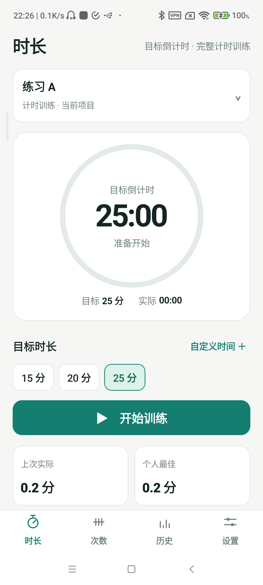
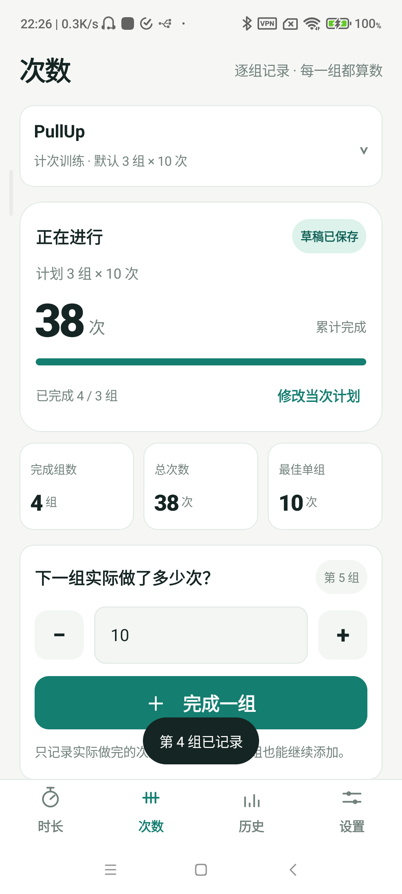
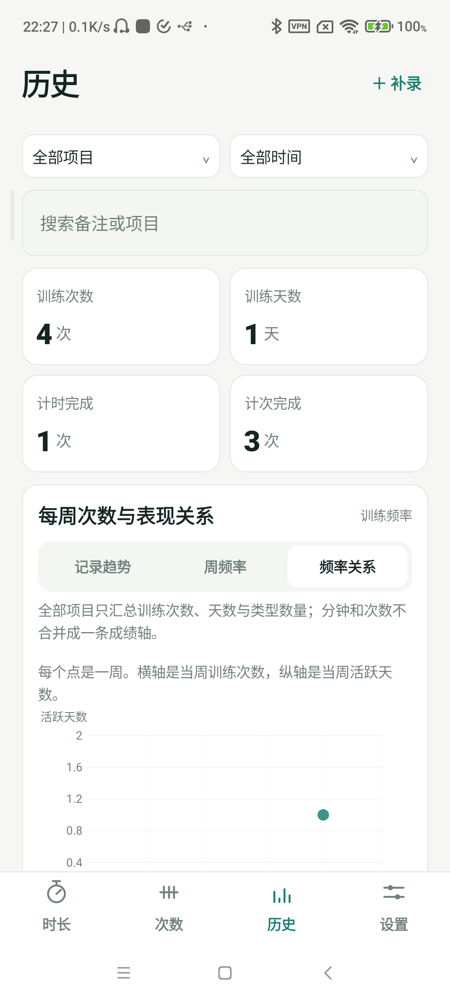

[简体中文](./README.md) | English

# Zai Jiu Yi Dian

A **local-first by default** Android app with two training modes: a real countdown timer and set-by-set rep logging, sharing full history and local backups. Cloud sync is off by default; it only goes online after you sign in from Settings and confirm the first upload.

<p>
  
  
  
</p>

*These screenshots were captured on a Redmi Note 11 5G (Android 11).*

- Local by default: only after you sign in from Settings and confirm the first upload does the app sync. With sync off, training, history and backups stay on the device.
- Four tabs: **Time / Reps / History / Settings**.
- Time mode keeps the countdown, pause/resume, overrun, target snapshot, and lock-screen cues.
- Reps mode records actual reps per set, with edit/undo/extra-set/early-finish and draft recovery.
- Per-project mode and goals; time and reps projects never mix units.
- Charts: performance trend, weekly frequency, frequency-vs-performance; time uses minutes, reps use total reps/best set, and "all projects" only combines session count and days.
- Backup: full JSON V3 (project mode, rep plans, per-set details, draft, settings) and CSV; V1/V2 backups remain readable.
- In-app font size: Settings → Appearance → Font size (100% / 115% / 130% / 145%, default 115%).
- Light theme by default, dark theme available.
- Voice feedback: a vibration + spoken "开始训练" on start, a spoken checkpoint every 3 minutes, and a spoken cue when the target is reached. Can be disabled under Settings → Training preferences → Voice reminders.
- End-of-timer alert: a high-priority alarm-channel notification plus a long vibration, so a finished countdown is noticeable in the background or on the lock screen (allow it through Do Not Disturb). Settings → Training preferences → "测试到点提醒" tests it.

## Cloud sync (optional, off by default)

- Entry: Settings → Cloud sync. While signed out or disabled, the app does not go online: no sync requests are made and no training data is uploaded.
- Sign-in: username + password only (CloudBase authentication). Phone, email, WeChat and anonymous sign-in are not enabled.
- Account isolation: cloud rows are scoped by owner (`owner_uid`), so an account only reads its own data.
- First upload: after sign-in the app shows a preview such as "2 projects, 5 sessions on this device" and uploads only after you confirm.
- Sync model: add/edit/delete first writes to a local outbox; the app then tries one upload immediately after saving, and also pulls increments by a server cursor (no whole-database overwrite). There is no network listener, background retry, or periodic polling — to see another device's changes, tap "Sync now", or make one more local change to trigger it.
- Offline/failure: training keeps working, changes wait locally, and a manual "Sync now" retries after the network returns.
- Sign-out: local tokens and sync state are cleared; local training data stays and cloud data is not deleted by signing out.
- Scope: sized for one account across two devices; quota, expiry and threshold handling are recorded in `docs/plan/共享云环境登记簿-P068.md`.

## Installation

APK: `dist/P068-zai-jiu-yi-dian-v1.2.0-debug.apk`

- Package: `com.wanghoufan.zaijiuyidian`
- Version: 1.2.0 (versionCode 4)
- Size: 17,010,870 bytes
- SHA-256: `0d22afbd144e06b2b9afa3e23f9ffe44b69286d774a4023053c5494d68fc0811`
- DEBUG test-signed build for personal sideloading, not a store release.

```bash
adb install -r -t dist/P068-zai-jiu-yi-dian-v1.2.0-debug.apk
```

On Xiaomi/HyperOS, if installation is rejected with `INSTALL_FAILED_USER_RESTRICTED`, enable Developer options → "Install via USB" and keep the screen awake. The switch may turn off after locking or rebooting.

## Build & test

Requires JDK 17 and Android SDK 36:

```bash
./gradlew :app:assembleDebug
./gradlew :app:testDebugUnitTest
```

## Known limitations

- Lock-screen/background cues and end-of-timer alerts require the foreground service, notification permission and exact-alarm permission; they may be silent or late if notifications are denied, Do Not Disturb/battery policy intervenes, or the system force-stops the app. Do Not Disturb must allow this alert. Elapsed time remains accurate when returning.
- End-of-timer alert is fixed; remaining limits are OEM battery policy (delayed alarms) and inexact fallback when exact-alarm permission is not granted. See `docs/risks.md` R14.
- Automatic local backups use a user-selected SAF folder, keep the last 7 versions, and can be previewed/restored with a safety checkpoint. Failure paths (write failure, revoked permission, reboot) still need per-device verification.
- V1.1 main paths verified on Redmi Note 11 5G (Android 11): four tabs, reps, all three charts, delete/restore, V3 export/replace/duplicate-merge, 145% font. Redmi Note 12 Pro (Android 14) verified install, v1→v2 migration, four tabs, and old data retention. Redmi Note 12T Pro (Android 15) verified install/hash/launch/migration; its full dual-mode flow is NOT_RUN.
- V1.2 cloud sync: verified on two devices for first-upload preview, two-device incremental consistency, non-overwriting conflict choice, tombstones not resurrecting, offline backfill, and token cleanup on sign-out. AC03/08/09/10 remain PARTIAL; see `docs/qa/产品验收追踪矩阵-P068-V1.2.md`.
- Test-signed; not published to any store; source committed and pushed to `main` (`693f685`).

See `docs/qa/产品验收追踪矩阵-P068-V1.2.md` and `docs/qa/QA-REPORT-P068-V1.1-R2.md` for evidence.

## Documentation

- Plans and prototypes: `docs/plan/`
- V1.2 cloud-sync plan and shared-environment register: `docs/plan/P068-V1.2-Cloud-Sync-Plan.md`, `docs/plan/共享云环境登记簿-P068.md`
- Acceptance matrix: `docs/qa/产品验收追踪矩阵-P068-V1.2.md` (V1.1/V1.0 matrices kept)
- QA evidence: `docs/qa/QA-REPORT-P068-V1.1-R2.md`, `docs/qa/evidence-v11/`, `docs/qa/evidence-v12/`
- Handoff: `docs/handoff/HANDOFF.md`